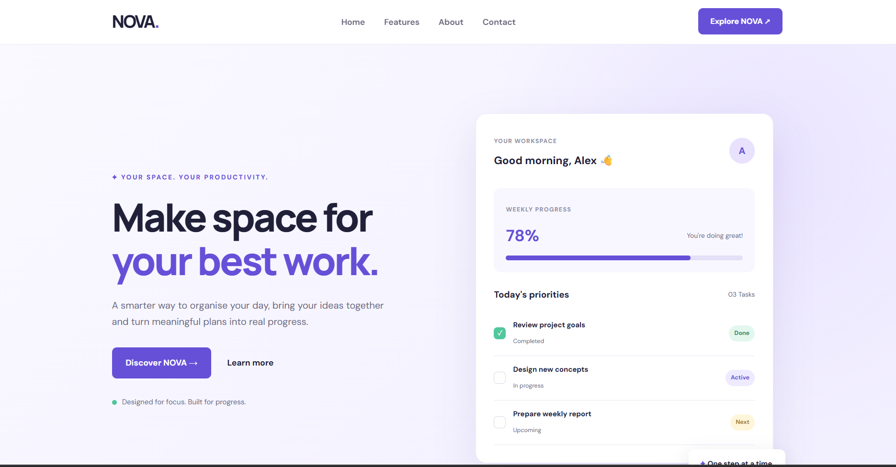
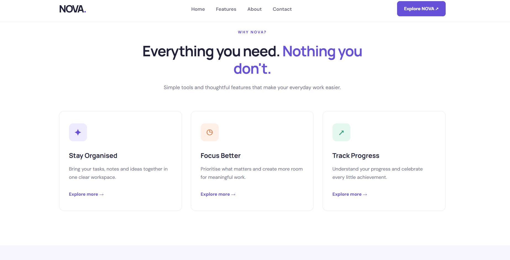
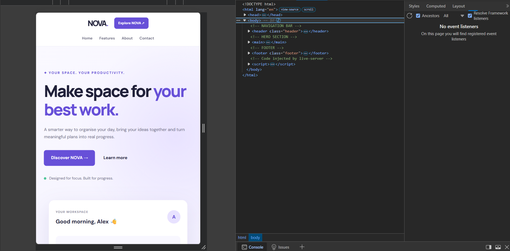

# NOVA – Modern Productivity Landing Page

## Project Overview

NOVA is a modern and responsive landing page designed for a fictional productivity workspace brand. The website focuses on a clean user interface, elegant design, and user-friendly navigation.

This project was developed as part of **Oasis Infobyte Internship – Web Development and Designing, Level 1, Task 1**.

## 🚀 Live Demo

[View Landing Page](https://aminafaiza.github.io/OIBSIP/landing-page/)

## Objectives

- Build a professional landing page using HTML5 and CSS3.
- Understand website structure and semantic HTML elements.
- Apply modern CSS styling and responsive design principles.
- Create an attractive and user-friendly interface.

## Features

- Modern hero section with a clear call-to-action.
- Responsive navigation bar.
- Features section with visually appealing cards.
- About section with a CSS illustration.
- Customer testimonials section.
- Call-to-action section.
- Clean footer with contact and social links.
- Responsive layout for desktop, tablet, and mobile screens.

## Technologies Used

- **HTML5** – Website structure and semantic elements.
- **CSS3** – Styling, layouts, animations, and responsiveness.
- **Google Fonts** – Typography.

## Project Structure

```text
WebDev-L1-LandingPage/
│
├── index.html
├── style.css
├── README.md
│
└── screenshots/
    ├── homepage.png
    ├── features.png
    └── mobile-view.png
```

## How to Run the Project

1. Clone or download the OIBSIP repository.
2. Open the `WebDev-L1-LandingPage` folder in Visual Studio Code.
3. Open `index.html` in your browser.

   Alternatively, use the Live Server extension in VS Code to launch the website.

## Screenshots

### Homepage


### Features Section


### Mobile Responsive View


## Internship Details

- **Organization:** Oasis Infobyte
- **Internship Track:** Web Development and Designing
- **Level:** Level 1
- **Task:** Task 1 – Landing Page
- **Project Name:** NOVA – Modern Productivity Landing Page

## Author

**Amina Faiza HS**

## Acknowledgement

I would like to thank Oasis Infobyte for providing this internship opportunity and helping me strengthen my web development skills.

---

*Developed as part of the Oasis Infobyte Web Development and Designing Internship.*
